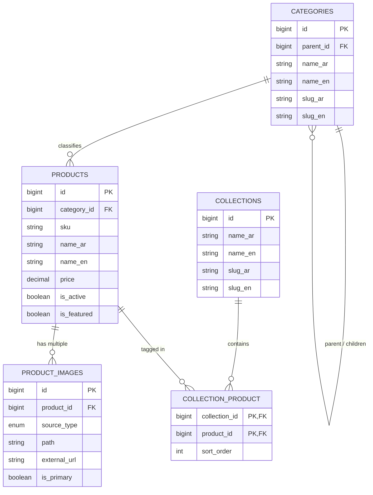
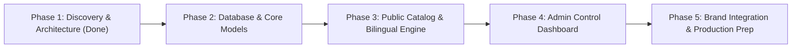

# Backend Architecture & Technical Specification
## Project: The Sultan Project — Sultan Fabrics (سلطان الأقمشة)

> **Document Status:** Architectural Proposal & Production Implementation Baseline (v1.1)  
> **Target Framework:** Laravel 13.x | **Runtime:** PHP 8.5.x | **Official Database Engine:** Oracle MySQL Server 8.4 LTS (Port 3307, Service: `MySQL84`)  
> **Author:** Senior Backend Architect & Technical Product Manager  
> **Last Updated:** November 2026  

---

## Table of Contents
1. [Project Overview](#1-project-overview)
2. [Business Goals](#2-business-goals)
3. [Target Audience](#3-target-audience)
4. [Business Requirements](#4-business-requirements)
5. [Functional Requirements](#5-functional-requirements)
6. [Non-Functional Requirements](#6-non-functional-requirements)
7. [Website Modules](#7-website-modules)
8. [Admin Dashboard Requirements](#8-admin-dashboard-requirements)
9. [Product Management Rules](#9-product-management-rules)
10. [Category and Collection Rules](#10-category-and-collection-rules)
11. [Bilingual Content Strategy](#11-bilingual-content-strategy)
12. [Media and Image Management Strategy](#12-media-and-image-management-strategy)
13. [WhatsApp Integration Requirements](#13-whatsapp-integration-requirements)
14. [SEO Requirements](#14-seo-requirements)
15. [Database Architecture Proposal](#15-database-architecture-proposal)
16. [Entity Relationship Overview](#16-entity-relationship-overview)
17. [Eloquent Relationship Strategy](#17-eloquent-relationship-strategy)
18. [Security and Authorization Requirements](#18-security-and-authorization-requirements)
19. [Recommended Laravel Folder Structure](#19-recommended-laravel-folder-structure)
20. [Validation and Error Handling Strategy](#20-validation-and-error-handling-strategy)
21. [Testing Strategy](#21-testing-strategy)
22. [Performance and Scalability Considerations](#22-performance-and-scalability-considerations)
23. [Backup and Deployment Considerations](#23-backup-and-deployment-considerations)
24. [Development Phases](#24-development-phases)
25. [Open Questions and Pending Business Decisions](#25-open-questions-and-pending-business-decisions)

---

## 1. Project Overview

**The Sultan Project** is a digital platform and high-end digital showroom built for **Sultan Fabrics (سلطان الأقمشة)**, a commercial enterprise specializing in premium fabrics and textile clothing.

### 1.1 Core Value Proposition
The platform serves as an interactive, content-rich catalog and brand authority hub. Rather than a transactional e-commerce platform with cart checkout and automated payment gateways, Sultan Fabrics utilizes a **high-touch conversational sales model**:
- Prospective buyers discover fabric lines, seasonal collections, photography, and detailed fabric specifications online.
- High-intent visitors convert directly into personalized business conversations via **direct WhatsApp integration**, connecting customers straight to sales consultants.

### 1.2 Explicit Non-Goals (Initial Release)
To keep development focused, lean, and aligned with current business realities, the following features are **explicitly out of scope** for Phase 1:
- Shopping cart and checkout workflows.
- Online payment gateway integration (e.g., Stripe, PayMob, Fawry, Tap).
- Real-time inventory deduction and stock level management.
- Complex product matrix variations (e.g., dynamic SKU stock per size/color).
- Automated order tracking and customer self-service billing accounts.

---

## 2. Business Goals

1. **Establish a High-Authority Digital Presence:** Position Sultan Fabrics as a market-leading textile and fabric destination with a polished, modern digital showroom.
2. **Elevate Brand Awareness & Trust:** Provide an authentic window into the business history, craftsmanship, and textile excellence.
3. **Streamline Product Discovery:** Enable prospective clients and tailors to filter, inspect, and evaluate fabric lines and marketing edits effortlessly.
4. **Drive Direct Sales Conversions (WhatsApp):** Transform digital interest into direct WhatsApp customer chats with pre-populated product inquiry payloads.
5. **Universal Bilingual Reach:** Deliver native, frictionless experiences for both Arabic-speaking and English-speaking markets without relying on crude machine translation.
6. **Organic Search Engine Visibility (SEO):** Implement robust on-page metadata, semantic schema, and fast-loading media to dominate organic search queries in the textiles sector.
7. **Empowered Non-Technical Administration:** Provide business administrators with complete, intuitive control over product catalogs, marketing collections, homepage banners, image galleries, and site settings.
8. **Architectural Longevity:** Establish a clean, extensible architectural foundation capable of transitioning into a transactional e-commerce system in later phases without re-architecting the core domain.

---

## 3. Target Audience

Understanding user behavior informs the backend design, query performance, and URL structure:

- **Retail Fabric Enthusiasts & Shoppers:** End-consumers seeking quality materials for custom tailoring, seasonal garments, or special occasions. They prioritize high-resolution photography, weave details, and direct contact.
- **Wholesale, Commercial, & Tailoring Partners:** Designers, ateliers, and tailoring houses scouting textile varieties, bulk availability indicators, and fabric specifications.
- **Social Media Inbound Traffic:** Mobile-first visitors clicking through from Instagram, TikTok, or Facebook ads/posts, requiring instant page rendering and immediate one-click WhatsApp inquiry buttons.
- **Bilingual Demographics:**
  - *Arabic-speaking visitors:* Primarily native RTL readers accustomed to intuitive localized messaging.
  - *English-speaking visitors:* Expatriates, international textile partners, and regional clients navigating LTR English interfaces.

---

## 4. Business Requirements

### 4.1 Confirmed Requirements
- **Digital Showroom Paradigm:** Presentation of products, categories, curated collections, photo gallery, size/fabric guide, and contact channels.
- **WhatsApp Conversion Funnel:** Single-click WhatsApp action on every product and general inquiry point.
- **Independent Bilingual Support:** Full separation of Arabic (`ar`) and English (`en`) for all textual content, URLs/slugs, SEO tags, and image captions.
- **Dual Image Sourcing:** Every media entity can originate from either a locally uploaded file (`storage/app/public`) or a verified external CDN/image URL.
- **Administrative Independence:** No code changes or developer intervention required for regular content updates.

### 4.2 Assumptions & Recommendations (Flagged for Client Alignment)
- *Assumption:* WhatsApp numbers may vary between general inquiries and bulk/wholesale requests, but initially a primary business WhatsApp number configured in `site_settings` is sufficient.
- *Recommendation:* Currency should be configurable globally in `site_settings` (e.g., EGP, SAR, AED, USD) with an optional display suffix, rather than hardcoding currency symbols into template views.
- *Recommendation:* Product prices should support an optional `is_price_on_request` or nullable price column to accommodate high-end luxury textiles or fluctuating wholesale items where prices are discussed exclusively via WhatsApp.

---

## 5. Functional Requirements

### 5.1 Public Digital Showroom
- **Homepage:** Dynamic hero slider/banner, featured collections showcase, highlighted product grid, introductory brand blurb, and direct inquiry CTA.
- **Product Catalog:** Paginated and filterable grid by Category, Subcategory, and Collection with sort options (Latest, Featured, Price).
- **Product Detail View:** Multi-image gallery with zoom-capable assets, fabric details, SKU, price display, related products, and pre-formatted WhatsApp inquiry trigger.
- **Collections Showcase:** Dedicated landing page displaying marketing collections (e.g., "Summer Linen Edit", "Royal Wool Selection") linking to collection-specific product grids.
- **Visual Gallery:** Masonry or grid-based showcase of business photography, fabric textures, workshop craftsmanship, and client creations with bilingual captions.
- **Informational Pages:** About Us, Size/Fabric Guide, Terms/Privacy, and flexible custom pages managed dynamically.
- **Contact Us:** Interactive contact details, Google Maps integration (optional link/embed), operating hours, social links, and an inquiry form that persists customer messages to the database for administrative review.

### 5.2 Content Administration
- Authentication and secure session management for system administrators.
- Full CRUD workflows for Categories (with self-referencing parent/child nesting).
- Full CRUD workflows for Products, including multi-image sorting and collection tagging.
- Full CRUD workflows for Marketing Collections.
- Media management supporting direct file uploads and external URLs.
- Homepage section ordering and banner toggle controls.
- Contact message inbox with read/unread statuses and direct reply links.
- Global site settings repository (contact numbers, WhatsApp numbers, social links, default SEO).

---

## 6. Non-Functional Requirements

### 6.1 Performance
- Page load time under 1.5 seconds for first-contentful paint on standard 4G mobile connections.
- Optimized database queries preventing N+1 query antipatterns using Eloquent eager loading (`with()`).
- High-efficiency media delivery utilizing WebP image formats, lazy loading, and responsive srcsets.
- Query result caching for static settings and navigation structures.

### 6.2 Security
- Strict protection against CSRF across all state-changing endpoints.
- Robust input sanitization and parameterized PDO queries against SQL injection.
- Secure file upload validation enforcing MIME-type inspection, file size caps, and filename sanitization.
- Rate limiting on public forms (e.g., contact submissions) to prevent spam and abuse (`throttle:contact-form`).
- Secure administrative session cookies with `HttpOnly`, `SameSite=Lax`, and `Secure` attributes enabled.

### 6.3 Reliability & Maintainability
- Strict adhere to PSR-12 and modern PHP 8.5 type safety (typed properties, return types).
- Clean database referential integrity with foreign key constraints and indexed lookup columns.
- Graceful degradation: if an external image URL fails or is unreachable, the system displays a local branded fallback placeholder.

---

## 7. Website Modules

```
                    +-------------------------------------+
                    |          PUBLIC SHOWROOM            |
                    +-------------------------------------+
                                       |
    +--------------+--------------+----+------------+---------------+
    |              |              |                 |               |
[Catalog]    [Collections]    [Gallery]        [Static Pages]    [Contact]
 - Products   - Campaigns      - Media Grid     - About Us        - Form
 - Categories - Edits          - Captions       - Size Guide      - Channels
 - Filters    - Highlights                      - Policy          - WhatsApp
                                       |
                    +-------------------------------------+
                    |       ADMIN CONTROL CENTER          |
                    +-------------------------------------+
                                       |
    +--------------+--------------+----+------------+---------------+
    |              |              |                 |               |
[Products &]  [Marketing &]   [Content &]       [Communications] [System &]
[Categories]  [Collections]   [Media Hub]       [Inbox]          [Settings]
```

1. **Catalog Module:** Products, Categories, Subcategories, Pricing, Statuses.
2. **Marketing Module:** Collections, Collection-Product pivots, Featured Banners.
3. **Media Module:** Polymorphic/Dedicated Image management (Local uploads vs External URLs).
4. **Showcase & Gallery Module:** Visual photo gallery, sliders, promotional callouts.
5. **Content & Pages Module:** Static/dynamic CMS pages (About Us, Size Guide, Policies).
6. **Communication Module:** Contact message ingestion, notification alerts, WhatsApp link generation.
7. **Settings & SEO Module:** Key-value system configurations, social channels, meta tags.

---

## 8. Admin Dashboard Requirements

The administration panel is the operational cockpit for Sultan Fabrics staff.

### 8.1 Functional Scope
- **Dashboard Overview:** Key metric counters (Total Products, Active Categories, Collections, Unread Inquiries).
- **Product Management:**
  - Tabbed or side-by-side bilingual entry fields (Arabic / English).
  - Category selector (with subcategory hierarchy).
  - Multi-collection checkboxes.
  - Image uploader supporting drag-and-drop ordering, primary image selection, and external URL inputs.
- **Category & Collection Management:**
  - Parent/child category selectors.
  - Thumbnail and banner image assignments.
- **Gallery Management:**
  - Bulk media upload or URL addition.
  - Bilingual caption editor.
  - Display sort ordering.
- **Homepage & Banner Management:**
  - Active hero slider manager (title, subtitle, CTA URL, background image).
  - Featured collection toggles.
- **Inquiry Inbox:**
  - Chronological list of customer contact form submissions.
  - Detailed message view with sender name, email, phone, and inquiry topic.
  - Status toggle (`unread`, `read`, `archived`).
- **Global Settings:**
  - Business phone numbers and primary WhatsApp contact number.
  - Social media profile URLs (Instagram, Facebook, TikTok, etc.).
  - Address and operating hours (bilingual).
  - Global default SEO meta titles and descriptions.

---

## 9. Product Management Rules

### 9.1 Data Attributes
Each product record strictly maintains:
- **Identification:** Auto-incrementing BigInteger ID, unique internal SKU (optional/nullable).
- **Bilingual Content:**
  - `name_ar` / `name_en` (Required)
  - `slug_ar` / `slug_en` (Required, URL-safe, unique)
  - `description_ar` / `description_en` (Rich-text or formatted text)
- **Categorization:** Mandatory `category_id` (foreign key to `categories`).
- **Commercial Data:**
  - `price` (Decimal 10,2 - nullable if price on request).
  - `is_price_on_request` (Boolean default `false`).
- **Media:** One primary thumbnail and zero or more secondary gallery images.
- **Visibility:**
  - `is_active` (Boolean default `true` - unpublished items hidden from public).
  - `is_featured` (Boolean default `false` - priority display on homepage).
- **Metadata:** Ordering weight (`sort_order`), timestamps, and soft deletes.

### 9.2 WhatsApp Inquiry Pre-Formatting
Every product view provides a direct WhatsApp action button. The URL format follows:
```
https://wa.me/{WHATSAPP_NUMBER}?text={ENCODED_MESSAGE}
```
The message text is contextualized to the active locale:
- **Arabic:** `مرحباً سلطان الأقمشة، أود الاستفسار عن منتج: [اسم المنتج] (كود: [SKU]) - الرابط: [رابط المنتج]`
- **English:** `Hello Sultan Fabrics, I would like to inquire about: [Product Name] (SKU: [SKU]) - Link: [Product URL]`

---

## 10. Category and Collection Rules

Understanding the fundamental business distinction between Categories and Collections is vital to proper schema normalization:

```
+--------------------------------------------------------------------------+
| CATEGORIES (Taxonomical Hierarchy)                                       |
| - Strictly hierarchical (e.g., Fabrics -> Natural -> Pure Italian Silk) |
| - Describes WHAT the physical product is.                                |
| - Every product belongs to exactly ONE primary category.                 |
+--------------------------------------------------------------------------+
                                     |
                                     v
                           [ PRODUCT RECORD ]
                                     ^
                                     |
+--------------------------------------------------------------------------+
| COLLECTIONS (Curated Marketing Groups)                                   |
| - Orthogonal / Cross-cutting (e.g., "Winter 2026", "VIP Wedding Line")   |
| - Describes HOW the product is marketed or grouped for campaigns.        |
| - A product can belong to ZERO, ONE, or MANY collections simultaneously. |
+--------------------------------------------------------------------------+
```

### 10.1 Category Rules
- Represents the intrinsic taxonomy of the catalog (e.g., Silks, Wool, Linens, Cottons).
- Supports nested subcategories via self-referential `parent_id` foreign key.
- Deleting a category with active products is restricted by database constraints (`RESTRICT` or graceful re-assignment) to prevent orphaned products.

### 10.2 Collection Rules
- Represents time-limited campaigns, seasonal catalogs, or stylistic edits.
- Implemented via a `collection_product` many-to-many pivot table.
- A collection can have its own promotional banner, start/end date, and display ordering.

---

## 11. Bilingual Content Strategy

The platform must support Arabic (`ar`) as primary and English (`en`) as secondary.

### 11.1 Evaluated Architectural Approaches

| Approach | Architecture | Pros | Cons | Recommendation |
|---|---|---|---|---|
| **A. Explicit Columns** | `name_ar`, `name_en`, `desc_ar`, `desc_en` in the same table. | Zero joins, fast performance, fully compatible with standard migrations, easiest validation rules. | Adds columns if adding 5+ languages. | **RECOMMENDED** for 2 fixed languages. |
| **B. JSON Translatable** | Single `name` column storing `{"ar": "...", "en": "..."}`. | Fewer columns, works with packages like Spatie Translatable. | Complex indexing for search, MariaDB JSON collation nuances in Arabic search queries. | Viable alternate, but adds query overhead. |
| **C. Translation Tables** | `products` table + `product_translations` table. | Infinite languages, clean schema separation. | Requires joins for every single query, excessive database overhead for a 2-language showroom. | Overengineered for this scope. |

### 11.2 Decision: Explicit Bilingual Columns
Given that Sultan Fabrics operates strictly in Arabic and English, **Approach A (Explicit Columns)** is selected for its superior reliability, native indexing, instant Eloquent attribute access, and zero-overhead performance on Oracle MySQL.

### 11.3 Locale Handling & Routing
- Route prefixing:
  - `https://domain.com/ar/products` (Arabic locale, RTL stylesheet layout)
  - `https://domain.com/en/products` (English locale, LTR stylesheet layout)
- A global middleware (`SetLocale`) inspects the first route parameter, updates `app()->setLocale()`, and shares directional attributes (`dir="rtl"` vs `dir="ltr"`) with views.
- Dedicated slugs for each language (`slug_ar` and `slug_en`) to maximize localized SEO value.

---

## 12. Media and Image Management Strategy

### 12.1 Dual-Source Model
In modern digital catalog management, images may either be uploaded by staff directly or hosted on high-speed external storage/CDNs.

Every image record in the database supports both methods via a clean abstraction:
- `source_type`: Enum or string: `'local'` vs `'external'`.
- `path`: Stores the relative storage path (e.g., `products/thumbnails/linen_blue.webp`) when `source_type = 'local'`.
- `external_url`: Stores the fully qualified HTTPS URL (e.g., `https://cdn.example.com/fabrics/img_01.jpg`) when `source_type = 'external'`.

### 12.2 Eloquent Image URL Accessor
Models implementing images will utilize an accessor (e.g., `$image->url`):
```php
public function getUrlAttribute(): string
{
    if ($this->source_type === 'external' && !empty($this->external_url)) {
        return $this->external_url;
    }

    if (!empty($this->path)) {
        return Storage::disk('public')->url($this->path);
    }

    return asset('images/placeholder-fabric.webp');
}
```

### 12.3 Filesystem Rules
- Uploaded files are stored in `storage/app/public/` using hashed filenames (`Str::random(40) . '.webp'`).
- Under no circumstances are local Windows paths (such as `E:\...`) persisted to the database.
- File uploads are validated: maximum size 4MB, allowed MIME types `jpeg`, `png`, `webp`, `avif`.

---

## 13. WhatsApp Integration Requirements

### 13.1 Technical Mechanism
WhatsApp interactions operate via the official WhatsApp Universal Click-to-Chat protocol (`wa.me`), requiring zero third-party messaging subscriptions for Phase 1.

### 13.2 Architecture
A dedicated service class, `WhatsAppService`, encapsulates all message formulation and phone sanitization:
- Strips non-numeric characters from administrative numbers (e.g., `+20 100 123 4567` -> `201001234567`).
- Builds URL-encoded UTF-8 strings ensuring Arabic letters and emojis are cleanly handled across all browsers.
- Supports pre-defined message templates:
  - `product_inquiry`: Embeds product title, SKU, price, and active URL.
  - `general_inquiry`: Standard greeting for the Contact page or floating widget.
  - `collection_inquiry`: Inquires about a specific seasonal edit.

---

## 14. SEO Requirements

Search Engine Optimization is a first-class citizen for Sultan Fabrics:

1. **Bilingual Meta Tags:** Independent `meta_title_ar`, `meta_title_en`, `meta_description_ar`, and `meta_description_en` on Products, Categories, Collections, and Pages.
2. **Canonical Links & Hreflang:** Dynamic `<link rel="alternate" hreflang="ar" href="...">` and `<link rel="alternate" hreflang="en" href="...">` tags to prevent duplicate content penalties.
3. **OpenGraph & Twitter Cards:** Automatic generation of `og:title`, `og:description`, `og:image`, and `og:locale` tags for rich preview cards on WhatsApp, Facebook, and X.
4. **Structured Data (JSON-LD):**
   - Homepage: `Organization` & `LocalBusiness` schema.
   - Products: `Product` schema detailing name, description, image, and price availability.
   - Breadcrumbs: `BreadcrumbList` schema.
5. **Clean Semantic Slugs:** Unique slugs per language with hyphen separation.

---

## 15. Database Architecture & Official Engine Specification

### 15.1 Official Database Engine: Oracle MySQL Server 8.4 LTS
The project officially runs on **Oracle MySQL Server 8.4 LTS** (Community Server x86_64).
- **Service Name:** `MySQL84` (Configured as a Windows Service set to `Automatic` startup).
- **Connection Port:** `3307` (Runs in parallel with development environments without port 3306 conflicts).
- **Storage Engine:** Standard `InnoDB` across all 20 tables with strict foreign key constraints and transactional integrity.
- **Character Set:** `utf8mb4` for comprehensive multilingual support.
- **Collation:** `utf8mb4_0900_ai_ci` — The modern Unicode 9.0+ UCA standard, providing accurate sorting, comparison, and search across both Arabic (handling hamza variations, tashkeel/harakat, and yeh/alef maksura) and English/Latin characters with accent and case insensitivity.
- **JSON Support:** Native binary `JSON` column format for configuration blocks (e.g., `home_sections.configuration`), mapped via Eloquent array casts.
- **Access Control:** Application traffic connects via a dedicated non-root user (`sultan_user`) with restricted privileges on `sultan_project.*`.

### 15.2 Database Setup & Maintenance Commands
```bash
# Verify connection & database schema
php artisan db:show

# Run migrations against Oracle MySQL
php artisan migrate

# Seed baseline business data & admin user
php artisan db:seed

# Execute full automated test suite (Feature & Livewire tests)
php artisan test
```

### 15.3 Tables Specification

#### 1. `users` (System Administrators)
| Column | Type | Constraints | Description |
|---|---|---|---|
| `id` | BIGINT UNSIGNED | PK, Auto-Increment | Unique identifier |
| `name` | VARCHAR(191) | NOT NULL | Administrator name |
| `email` | VARCHAR(191) | UNIQUE, NOT NULL | Login email |
| `password` | VARCHAR(255) | NOT NULL | Bcrypt hashed password |
| `remember_token`| VARCHAR(100) | NULLABLE | Session remember token |
| `created_at` / `updated_at` | TIMESTAMP | NULLABLE | Timestamps |

#### 2. `categories`
| Column | Type | Constraints | Description |
|---|---|---|---|
| `id` | BIGINT UNSIGNED | PK, Auto-Increment | Category ID |
| `parent_id` | BIGINT UNSIGNED | NULLABLE, FK (`categories.id` ON DELETE SET NULL) | Parent category for nesting |
| `name_ar` | VARCHAR(191) | NOT NULL | Arabic category name |
| `name_en` | VARCHAR(191) | NOT NULL | English category name |
| `slug_ar` | VARCHAR(191) | UNIQUE, NOT NULL, INDEX | Arabic URL slug |
| `slug_en` | VARCHAR(191) | UNIQUE, NOT NULL, INDEX | English URL slug |
| `description_ar`| TEXT | NULLABLE | Arabic description |
| `description_en`| TEXT | NULLABLE | English description |
| `source_type` | ENUM('local', 'external') | DEFAULT 'local' | Image source origin |
| `image_path` | VARCHAR(255) | NULLABLE | Local storage path |
| `image_url` | VARCHAR(500) | NULLABLE | External CDN image URL |
| `sort_order` | INT | DEFAULT 0, INDEX | Sorting priority |
| `is_active` | BOOLEAN | DEFAULT TRUE, INDEX | Visibility toggle |
| `meta_title_ar` / `en` | VARCHAR(191) | NULLABLE | SEO titles |
| `meta_desc_ar` / `en` | TEXT | NULLABLE | SEO descriptions |
| `created_at` / `updated_at` | TIMESTAMP | NULLABLE | Timestamps |

#### 3. `products`
| Column | Type | Constraints | Description |
|---|---|---|---|
| `id` | BIGINT UNSIGNED | PK, Auto-Increment | Product ID |
| `category_id` | BIGINT UNSIGNED | NOT NULL, FK (`categories.id` ON DELETE RESTRICT) | Primary Category |
| `sku` | VARCHAR(100) | NULLABLE, UNIQUE, INDEX | Stock Keeping Unit / Code |
| `name_ar` | VARCHAR(191) | NOT NULL | Arabic product name |
| `name_en` | VARCHAR(191) | NOT NULL | English product name |
| `slug_ar` | VARCHAR(191) | UNIQUE, NOT NULL, INDEX | Arabic URL slug |
| `slug_en` | VARCHAR(191) | UNIQUE, NOT NULL, INDEX | English URL slug |
| `description_ar`| TEXT | NULLABLE | Arabic full description |
| `description_en`| TEXT | NULLABLE | English full description |
| `price` | DECIMAL(10,2) | NULLABLE | Display price |
| `is_price_on_request` | BOOLEAN | DEFAULT FALSE | Price hidden / contact flag |
| `is_featured` | BOOLEAN | DEFAULT FALSE, INDEX | Showcase on homepage |
| `is_active` | BOOLEAN | DEFAULT TRUE, INDEX | Visibility toggle |
| `sort_order` | INT | DEFAULT 0, INDEX | Ordering index |
| `meta_title_ar` / `en` | VARCHAR(191) | NULLABLE | SEO meta titles |
| `meta_desc_ar` / `en` | TEXT | NULLABLE | SEO meta descriptions |
| `created_at` / `updated_at` | TIMESTAMP | NULLABLE | Timestamps |
| `deleted_at` | TIMESTAMP | NULLABLE | Soft delete timestamp |

#### 4. `product_images`
| Column | Type | Constraints | Description |
|---|---|---|---|
| `id` | BIGINT UNSIGNED | PK, Auto-Increment | Image ID |
| `product_id` | BIGINT UNSIGNED | NOT NULL, FK (`products.id` ON DELETE CASCADE) | Owning product |
| `source_type` | ENUM('local', 'external') | DEFAULT 'local' | Origin type |
| `path` | VARCHAR(255) | NULLABLE | Relative storage path |
| `external_url`| VARCHAR(500) | NULLABLE | Direct external URL |
| `alt_text_ar` | VARCHAR(191) | NULLABLE | Arabic accessibility alt |
| `alt_text_en` | VARCHAR(191) | NULLABLE | English accessibility alt |
| `is_primary` | BOOLEAN | DEFAULT FALSE, INDEX | Primary display thumbnail |
| `sort_order` | INT | DEFAULT 0, INDEX | Gallery ordering index |
| `created_at` / `updated_at` | TIMESTAMP | NULLABLE | Timestamps |

#### 5. `collections`
| Column | Type | Constraints | Description |
|---|---|---|---|
| `id` | BIGINT UNSIGNED | PK, Auto-Increment | Collection ID |
| `name_ar` | VARCHAR(191) | NOT NULL | Arabic collection title |
| `name_en` | VARCHAR(191) | NOT NULL | English collection title |
| `slug_ar` | VARCHAR(191) | UNIQUE, NOT NULL, INDEX | Arabic URL slug |
| `slug_en` | VARCHAR(191) | UNIQUE, NOT NULL, INDEX | English URL slug |
| `description_ar`| TEXT | NULLABLE | Arabic campaign blurb |
| `description_en`| TEXT | NULLABLE | English campaign blurb |
| `source_type` | ENUM('local', 'external') | DEFAULT 'local' | Banner origin |
| `banner_path` | VARCHAR(255) | NULLABLE | Local banner file |
| `banner_url` | VARCHAR(500) | NULLABLE | External banner URL |
| `is_featured` | BOOLEAN | DEFAULT FALSE, INDEX | Feature on homepage |
| `is_active` | BOOLEAN | DEFAULT TRUE, INDEX | Visibility toggle |
| `sort_order` | INT | DEFAULT 0, INDEX | Ordering index |
| `meta_title_ar` / `en` | VARCHAR(191) | NULLABLE | SEO meta titles |
| `meta_desc_ar` / `en` | TEXT | NULLABLE | SEO meta descriptions |
| `created_at` / `updated_at` | TIMESTAMP | NULLABLE | Timestamps |

#### 6. `collection_product` (Pivot Table)
| Column | Type | Constraints | Description |
|---|---|---|---|
| `collection_id`| BIGINT UNSIGNED | NOT NULL, FK (`collections.id` ON DELETE CASCADE) | Collection reference |
| `product_id` | BIGINT UNSIGNED | NOT NULL, FK (`products.id` ON DELETE CASCADE) | Product reference |
| `sort_order` | INT | DEFAULT 0 | Order within collection |
| PRIMARY KEY (`collection_id`, `product_id`) | - | Compound PK | Prevents duplicate associations |

#### 7. `gallery_items`
| Column | Type | Constraints | Description |
|---|---|---|---|
| `id` | BIGINT UNSIGNED | PK, Auto-Increment | Item ID |
| `title_ar` | VARCHAR(191) | NULLABLE | Arabic photo title |
| `title_en` | VARCHAR(191) | NULLABLE | English photo title |
| `caption_ar` | TEXT | NULLABLE | Arabic caption |
| `caption_en` | TEXT | NULLABLE | English caption |
| `source_type` | ENUM('local', 'external') | DEFAULT 'local' | Origin type |
| `path` | VARCHAR(255) | NULLABLE | Local file path |
| `external_url`| VARCHAR(500) | NULLABLE | External CDN URL |
| `sort_order` | INT | DEFAULT 0, INDEX | Display sequence |
| `is_active` | BOOLEAN | DEFAULT TRUE, INDEX | Visibility toggle |
| `created_at` / `updated_at` | TIMESTAMP | NULLABLE | Timestamps |

#### 8. `sliders` (Hero Banners)
| Column | Type | Constraints | Description |
|---|---|---|---|
| `id` | BIGINT UNSIGNED | PK, Auto-Increment | Slider ID |
| `title_ar` | VARCHAR(191) | NULLABLE | Arabic headline |
| `title_en` | VARCHAR(191) | NULLABLE | English headline |
| `subtitle_ar` | VARCHAR(191) | NULLABLE | Arabic subtitle |
| `subtitle_en` | VARCHAR(191) | NULLABLE | English subtitle |
| `button_text_ar`| VARCHAR(100) | NULLABLE | Arabic CTA text |
| `button_text_en`| VARCHAR(100) | NULLABLE | English CTA text |
| `button_url` | VARCHAR(500) | NULLABLE | Destination link |
| `source_type` | ENUM('local', 'external') | DEFAULT 'local' | Image source |
| `image_path` | VARCHAR(255) | NULLABLE | Local storage path |
| `image_url` | VARCHAR(500) | NULLABLE | External URL |
| `sort_order` | INT | DEFAULT 0, INDEX | Sequence |
| `is_active` | BOOLEAN | DEFAULT TRUE, INDEX | Visibility toggle |
| `created_at` / `updated_at` | TIMESTAMP | NULLABLE | Timestamps |

#### 9. `pages` (Content Management)
| Column | Type | Constraints | Description |
|---|---|---|---|
| `id` | BIGINT UNSIGNED | PK, Auto-Increment | Page ID |
| `slug` | VARCHAR(100) | UNIQUE, NOT NULL, INDEX | System key (`about-us`, `size-guide`) |
| `title_ar` | VARCHAR(191) | NOT NULL | Arabic page title |
| `title_en` | VARCHAR(191) | NOT NULL | English page title |
| `content_ar` | LONGTEXT | NULLABLE | Arabic page HTML/Markdown |
| `content_en` | LONGTEXT | NULLABLE | English page HTML/Markdown |
| `meta_title_ar` / `en` | VARCHAR(191) | NULLABLE | SEO title |
| `meta_desc_ar` / `en` | TEXT | NULLABLE | SEO description |
| `is_active` | BOOLEAN | DEFAULT TRUE | Active toggle |
| `created_at` / `updated_at` | TIMESTAMP | NULLABLE | Timestamps |

#### 10. `contact_messages` (Inquiries)
| Column | Type | Constraints | Description |
|---|---|---|---|
| `id` | BIGINT UNSIGNED | PK, Auto-Increment | Message ID |
| `name` | VARCHAR(191) | NOT NULL | Inquirer full name |
| `email` | VARCHAR(191) | NULLABLE | Inquirer email |
| `phone` | VARCHAR(50) | NOT NULL | Inquirer phone number |
| `subject` | VARCHAR(191) | NULLABLE | Inquiry subject |
| `message` | TEXT | NOT NULL | Message body |
| `is_read` | BOOLEAN | DEFAULT FALSE, INDEX | Admin read flag |
| `ip_address` | VARCHAR(45) | NULLABLE | Client IP for rate-limit auditing |
| `created_at` / `updated_at` | TIMESTAMP | NULLABLE | Timestamps |

#### 11. `site_settings` (Global Configuration)
| Column | Type | Constraints | Description |
|---|---|---|---|
| `id` | BIGINT UNSIGNED | PK, Auto-Increment | Setting ID |
| `key` | VARCHAR(100) | UNIQUE, NOT NULL, INDEX | Config key (e.g., `whatsapp_number`) |
| `value` | TEXT | NULLABLE | Plain string or JSON value |
| `group` | VARCHAR(50) | DEFAULT 'general', INDEX| Group (`contact`, `social`, `seo`) |
| `created_at` / `updated_at` | TIMESTAMP | NULLABLE | Timestamps |

---

## 16. Entity Relationship Overview



---

## 17. Eloquent Relationship Strategy

### 17.1 Category Model
```php
public function parent(): BelongsTo
{
    return $this->belongsTo(Category::class, 'parent_id');
}

public function children(): HasMany
{
    return $this->hasMany(Category::class, 'parent_id')->orderBy('sort_order');
}

public function products(): HasMany
{
    return $this->hasMany(Product::class);
}
```

### 17.2 Product Model
```php
public function category(): BelongsTo
{
    return $this->belongsTo(Category::class);
}

public function images(): HasMany
{
    return $this->hasMany(ProductImage::class)->orderBy('sort_order');
}

public function primaryImage(): HasOne
{
    return $this->hasOne(ProductImage::class)->where('is_primary', true);
}

public function collections(): BelongsToMany
{
    return $this->belongsToMany(Collection::class, 'collection_product')
                ->withPivot('sort_order')
                ->withTimestamps();
}
```

### 17.3 Collection Model
```php
public function products(): BelongsToMany
{
    return $this->belongsToMany(Product::class, 'collection_product')
                ->withPivot('sort_order')
                ->withTimestamps()
                ->orderByPivot('sort_order');
}
```

---

## 18. Security and Authorization Requirements

1. **Authentication:** Standard Laravel session authentication using secure Bcrypt passwords and guarded admin routes (`/admin/*`).
2. **Access Control:** All administrative routes are protected by the `auth` middleware. If multiple staff roles (e.g., Editor vs Administrator) are required in later phases, Laravel Gates can be mapped cleanly to a `role` attribute without needing heavyweight packages.
3. **Mass-Assignment Protection:** All Eloquent models strictly whitelist `$fillable` attributes or leverage guarded identifiers.
4. **XSS Prevention:** Automatic Blade output escaping (`{{ $content }}`) on all public templates. Raw HTML output (`{!! $content !!}`) is strictly restricted to sanitized admin CMS page content using HTMLPurifier or strict sanitization rules.
5. **Rate Limiting:** Contact inquiry submissions are throttled using Laravel's RateLimiter to 5 requests per minute per IP address.

---

## 19. Recommended Laravel Folder Structure

The application will follow a clean, maintainable structure that organizes code by domain responsibility:

```
app/
|-- Http/
|   |-- Controllers/
|   |   |-- Admin/
|   |   |   |-- CategoryController.php
|   |   |   |-- CollectionController.php
|   |   |   |-- ContactMessageController.php
|   |   |   |-- DashboardController.php
|   |   |   |-- GalleryController.php
|   |   |   |-- PageController.php
|   |   |   |-- ProductController.php
|   |   |   |-- SettingController.php
|   |   |   `-- SliderController.php
|   |   `-- Public/
|   |       |-- CatalogController.php
|   |       |-- CollectionController.php
|   |       |-- ContactController.php
|   |       |-- GalleryController.php
|   |       |-- HomeController.php
|   |       `-- PageController.php
|   |-- Middleware/
|   |   |-- AdminAuthenticate.php
|   |   `-- SetLocale.php
|   `-- Requests/
|       |-- Admin/
|       |   |-- CategoryRequest.php
|       |   |-- CollectionRequest.php
|       |   |-- ProductRequest.php
|       |   `-- SettingRequest.php
|       `-- ContactFormRequest.php
|-- Models/
|   |-- Category.php
|   |-- Collection.php
|   |-- ContactMessage.php
|   |-- GalleryItem.php
|   |-- Page.php
|   |-- Product.php
|   |-- ProductImage.php
|   |-- SiteSetting.php
|   |-- Slider.php
|   `-- User.php
|-- Services/
|   |-- MediaService.php
|   |-- SettingService.php
|   `-- WhatsAppService.php
`-- View/
    `-- Components/
        |-- ProductCard.php
        |-- WhatsAppButton.php
        `-- SeoMeta.php
```

---

## 20. Validation and Error Handling Strategy

### 20.1 Form Requests
Validation logic is isolated into dedicated `FormRequest` classes:
- Ensures incoming data is validated before touching controllers.
- Validates bilingual inputs simultaneously:
  ```php
  'name_ar' => ['required', 'string', 'max:191'],
  'name_en' => ['required', 'string', 'max:191'],
  'price'   => ['nullable', 'numeric', 'min:0'],
  'images.*.file' => ['nullable', 'image', 'mimes:jpeg,png,webp', 'max:4096'],
  'images.*.external_url' => ['nullable', 'url', 'max:500'],
  ```

### 20.2 Error Handling & Logging
- User-friendly localized error messages in Arabic and English.
- All non-recoverable exceptions are logged to `storage/logs/laravel.log` with contextual data.
- Custom public 404 and 500 error views styled consistently with the Sultan Fabrics brand layout.

---

## 21. Testing Strategy

1. **Unit Tests (`tests/Unit`):**
   - Verification of `WhatsAppService` URL formatting and phone number sanitization.
   - Verification of `MediaService` storage path resolution and fallback URL logic.
   - Verification of bilingual slug generator helpers.
2. **Feature Tests (`tests/Feature`):**
   - Public route resolution across both `/ar` and `/en` prefixes.
   - Product catalog filtering by category and collection.
   - Contact form submission, validation, rate limiting, and persistence.
   - Admin authentication guards preventing unauthenticated access to `/admin/*`.
   - Full CRUD testing for Products and Categories including file upload simulations (`Storage::fake('public')`).

---

## 22. Performance and Scalability Considerations

1. **Eager Loading Defaults:** Public catalog queries will strictly apply `Product::with(['category', 'primaryImage'])` to prevent N+1 query bottlenecks.
2. **Database Indexing:** Strategic B-tree indexes applied on all filter columns: `category_id`, `is_active`, `is_featured`, `sort_order`, `slug_ar`, and `slug_en`.
3. **Settings Caching:** Site settings (`site_settings`) loaded and cached in memory using `Cache::rememberForever('site_settings', ...)` and invalidated automatically upon admin updates.
4. **OPcache Optimization:** Leveraging PHP 8.5's Zend OPcache (which is pre-configured and verified) for zero script re-compilation overhead.

---

## 23. Backup and Deployment Considerations

1. **Storage Link:** Symlink creation via `php artisan storage:link` targeting `storage/app/public` to `public/storage`.
2. **Database Backups:** Automated daily Oracle MySQL dump (`mysqldump -h 127.0.0.1 -P 3307 -u sultan_user sultan_project > backup.sql`) protecting business data.
3. **Environment Segregation:** Strict separation of `.env` configurations; production flags: `APP_ENV=production` and `APP_DEBUG=false`.
4. **Windows/XAMPP Specifics:** Storage directories explicitly configured with relative storage disk drivers to maintain portability across staging and production hosts.

---

## 24. Development Phases



- **Phase 1 (Current):** Project Discovery, Architectural Design, and Documentation (`BACKEND.md`).
- **Phase 2:** Database Implementation (Migrations, Seeders, Core Models, Relationships).
- **Phase 3:** Public Showroom Implementation (Bilingual Routing, Catalog, Collections, Gallery, WhatsApp Service).
- **Phase 4:** Admin Dashboard Implementation (Authentication, Product/Category CRUD, Media Handling, Settings).
- **Phase 5:** Final Frontend Polish (awaiting brand identity), SEO audits, and deployment sign-off.

---

## 25. Open Questions and Pending Business Decisions

The following items are intentionally open and require formal confirmation from the business stakeholders before finalization:

1. **Price Visibility Policy:**
   - *Question:* Should all products display a specific price, or should certain premium/imported fabrics feature "Price Upon Request" (سعر عند الطلب)?
   - *Proposed Architecture:* Included an `is_price_on_request` boolean column to support both modes seamlessly.
2. **WhatsApp Department Routing:**
   - *Question:* Does Sultan Fabrics have a single unified WhatsApp number for all inquiries, or separate numbers for Retail Showroom vs Wholesale/Export inquiries?
   - *Proposed Architecture:* Implemented configurable setting keys (`whatsapp_general`, `whatsapp_wholesale`).
3. **Product Attribute Specifications:**
   - *Question:* Beyond standard text descriptions, does the business require structured fabric attribute pills (e.g., Fabric Composition, Country of Origin, Roll Width, Recommended Season)?
   - *Proposed Architecture:* Can easily be stored in a clean JSON column or separate key-value attribute table if confirmed.
4. **Brand Visual Identity Status:**
   - *Decision Pending:* Official logo files, brand color palette (hex codes), and typography have not yet been selected by the business owner. Frontend template development remains deferred until these brand assets are formally delivered.
